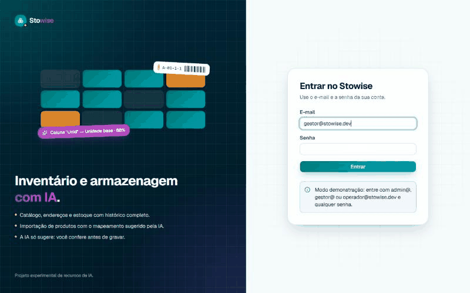
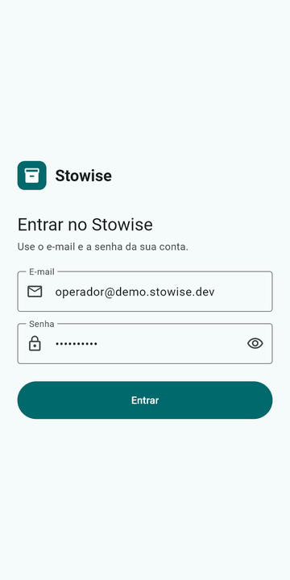
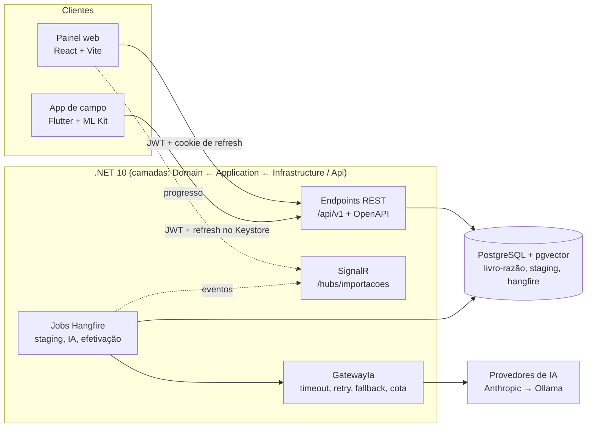

# Stowise

[](https://github.com/marivaldojunior/stowise/actions/workflows/api.yml)
[](https://github.com/marivaldojunior/stowise/actions/workflows/web.yml)
[](https://github.com/marivaldojunior/stowise/actions/workflows/e2e.yml)
[](https://github.com/marivaldojunior/stowise/actions/workflows/mobile.yml)

> [!NOTE]
> **Projeto experimental.** O Stowise é um laboratório de recursos de IA na API, no painel web e no app mobile. O código está em desenvolvimento ativo e não está pronto para produção. As APIs, o modelo de dados e as telas podem mudar sem aviso.

O Stowise testa recursos de IA sobre um caso real: um sistema de inventário e armazenagem. A regra de todo o projeto é simples: **a IA sugere e uma pessoa sempre confirma**. O nome junta *stow* (armazenar) e *wise* (inteligente).

| Parte | Pasta | Stack |
| --- | --- | --- |
| API | [`api/`](api) | .NET 10, EF Core, PostgreSQL + pgvector, Hangfire, SignalR, Microsoft.Extensions.AI |
| Painel de gestão | [`web/`](web) | React 19 + TypeScript (Vite), TanStack Query, shadcn/ui, cliente gerado do OpenAPI (orval) |
| App de campo | [`mobile/`](mobile) | Flutter 3.44, Riverpod, go_router, ML Kit, cliente gerado do OpenAPI (dart-dio) |

## O que já funciona (Marco 1)

| Frente | Recursos |
| --- | --- |
| API | Catálogo com embalagens, armazéns, zonas e endereços (geração em lote), estoque como livro-razão (entrada, saída, transferência, ajuste e reserva, com idempotência), autenticação com JWT e refresh rotativo, importação de produtos por CSV, TXT ou Excel em background, com **mapeamento de colunas sugerido pela IA** e prévia antes de gravar |
| Painel web | Catálogo, endereços com mapa de ocupação, saldos e extrato, usuários e perfis, importação com revisão da sugestão da IA e progresso em tempo real |
| App | Login, leitura de código de barras no aparelho (ML Kit ou leitor do coletor), entrada, saída e transferência, e consulta de saldo por produto ou endereço |

<p align="center">
  
  &nbsp;
  
</p>

Planejado nos próximos marcos ([plano completo](docs/SPEC.md)): NF-e com casamento de itens por IA e sugestão de endereço explicável, inventário offline no app, busca semântica com pgvector, consulta em linguagem natural e perguntas sobre documentos (RAG).

Regras que valem para todos os recursos de IA:

- A chave do provedor de IA fica só na API. O painel web e o app nunca chamam o provedor.
- Nenhum resultado de IA é gravado sem a confirmação de uma pessoa.
- Toda resposta da IA tem JSON Schema e é validada; toda chamada tem timeout, nova tentativa, provedor reserva, cota por usuário e registro.
- As decisões de armazenagem usam um motor de pontuação com regras explicáveis, sem LLM.
- Sem IA, todos os fluxos continuam a funcionar de forma manual.

## Arquitetura



- O contrato `api/openapi/v1.json` é versionado; o painel e o app geram o cliente a partir dele, e o CI falha se o cliente não bater com o contrato.
- Toda mudança de estoque passa pelo serviço de movimentação: o saldo é uma projeção do livro-razão, nunca alterado direto.
- Trabalho longo (importação, IA) roda em jobs idempotentes; o painel acompanha pelo SignalR.

## Decisões técnicas

Cada decisão tem um ADR em [`docs/adr/`](docs/adr) com o contexto e as alternativas. Para estudar o projeto, com perguntas de revisão e um roteiro de leitura do código, veja o [guia de estudo](docs/guia-de-estudo.md). Em uma linha, o que cada uma custa:

| ADR | Decisão | Trade-off |
| --- | --- | --- |
| [0001](docs/adr/0001-livro-razao-saldo-projetado.md) | Livro-razão de movimentações + saldo projetado | Auditoria completa e saldo em qualquer data, ao custo de mais escrita por operação e de nunca editar o saldo direto |
| [0002](docs/adr/0002-solucao-em-camadas.md) | API em camadas (Domain, Application, Infrastructure, Api) | Domínio testável sem banco, ao custo de mais projetos e mapeamentos |
| [0003](docs/adr/0003-patrimonio-modulo-separado.md) | Patrimônio como módulo separado do estoque | Regras de ativo não contaminam o estoque, ao custo de dois livros-razão |
| [0004](docs/adr/0004-camada-de-ia.md) | IA atrás da API, com saída validada, resiliência e cota | Chave segura, custo controlado e troca de provedor por configuração, ao custo de latência e de um contrato por funcionalidade |
| [0005](docs/adr/0005-autenticacao.md) | Identity, JWT próprio e refresh token rotativo | Sem serviço externo de login e com detecção de reuso, ao custo de manter o fluxo de tokens no projeto |
| [0006](docs/adr/0006-idempotencia-e-concorrencia.md) | Idempotência por chave do cliente e concorrência otimista | Reenvio seguro em rede ruim e sem saldo negativo por corrida, ao custo de uma chave por operação e de novas tentativas |
| [0007](docs/adr/0007-jobs-em-background.md) | Jobs com Hangfire no mesmo PostgreSQL | Sem fila externa para operar, ao custo de carga de polling no banco |
| [0008](docs/adr/0008-arquitetura-do-app.md) | App com Riverpod, go_router, flavors e cliente gerado | Dependências trocáveis nos testes e tipos iguais aos da API, ao custo do código gerado no repositório |
| [0009](docs/adr/0009-deploy-de-demonstracao.md) | Demonstração numa só imagem no Render, banco no Neon | Custo zero e uma só origem (sem CORS), ao custo de a primeira visita acordar o serviço (cerca de 30 s) |

## Pré-requisitos

- .NET SDK 10.0.400+
- Node.js 24
- Flutter 3.44 (e Java 21 para gerar o cliente do app)
- Docker (para o banco e a API completa)

## Rodando localmente

Tudo com Docker (banco, API e Aspire Dashboard):

```bash
cp .env.example .env
docker compose up -d --build
```

- API: http://localhost:8080/health/ready · referência (Scalar): http://localhost:8080/scalar · contrato: http://localhost:8080/openapi/v1.json
- Aspire Dashboard (traces, métricas e logs): http://localhost:18888
- PostgreSQL: `localhost:5432` (usuário, senha e banco `stowise`)
- Admin de desenvolvimento: `admin@stowise.dev` / `Stowise-dev-2026`

Cada parte fora do Docker:

```bash
docker compose up -d db
dotnet run --project api/src/Stowise.Api                 # http://localhost:5073
npm --prefix web install && npm --prefix web run dev     # http://localhost:5173 (repassa /api para a API)
cd mobile && flutter run --flavor dev -t lib/main_dev.dart   # emulador Android: API em http://10.0.2.2:5073
```

Só o painel, sem API nem banco (dados de exemplo no navegador):

```bash
npm --prefix web install && npm --prefix web run dev:demo
```

Imagem de demonstração (API + painel na mesma origem) e deploy no Render com o banco no Neon: [`docs/deploy.md`](docs/deploy.md).

## Qualidade

| Frente | Testes | No CI |
| --- | --- | --- |
| API | xUnit (unidade) e integração com PostgreSQL real (Testcontainers); contrato OpenAPI verificado | Build, formatação, testes com banco obrigatórios |
| Web | Vitest + Testing Library com MSW (rede falsa, requisição sem handler falha o teste); Playwright contra a API real | Lint, tipos, testes, build, cliente gerado igual ao contrato, e2e e imagem de demonstração |
| App | Unidade, widget e golden (referência no Linux); integração do fluxo do operador | Formatação, análise, testes, emulador Android e APK por arquitetura |

## Contribuindo

Veja [`CONTRIBUTING.md`](CONTRIBUTING.md): uma tarefa do plano por vez, testes obrigatórios e Conventional Commits.

## Licença

Copyright (c) 2026 Marivaldo Junior. Distribuído sob a [PolyForm Strict 1.0.0](LICENSE): o código pode ser lido, estudado e executado para fins não comerciais, mas não pode ser modificado, redistribuído nem usado em trabalhos derivados ou para fins comerciais sem autorização por escrito do autor.

- As versões publicadas antes desta troca (incluindo a tag `v0.1.0`) continuam sob a Apache 2.0 para quem obteve uma cópia delas.
- As dependências e os componentes de terceiros mantêm as próprias licenças.
- Para outro uso, abra uma issue ou fale com o autor.
